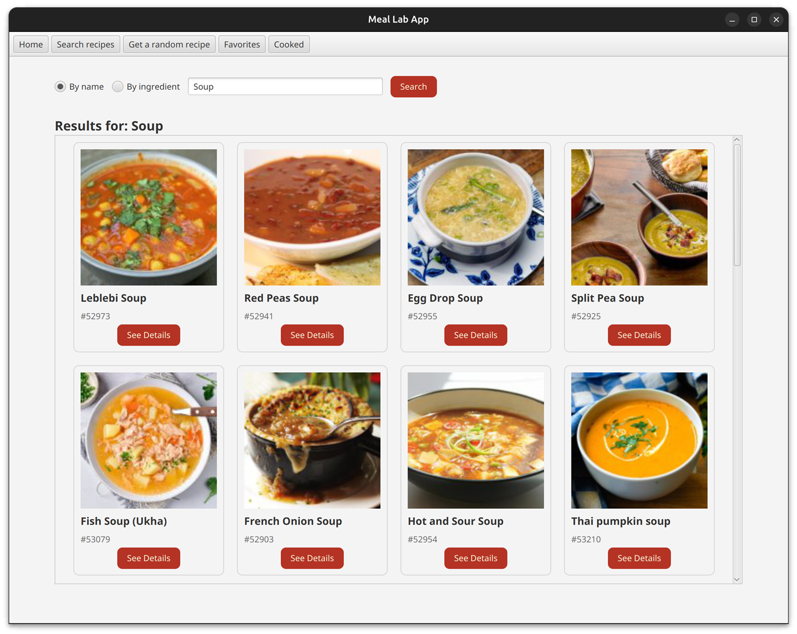
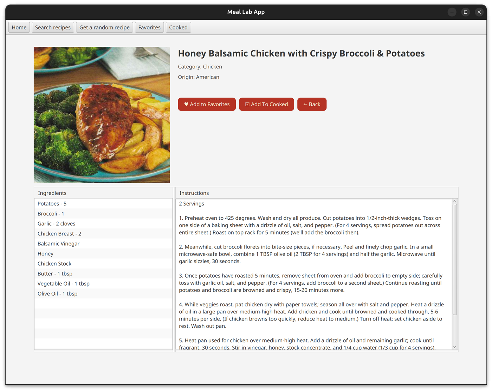
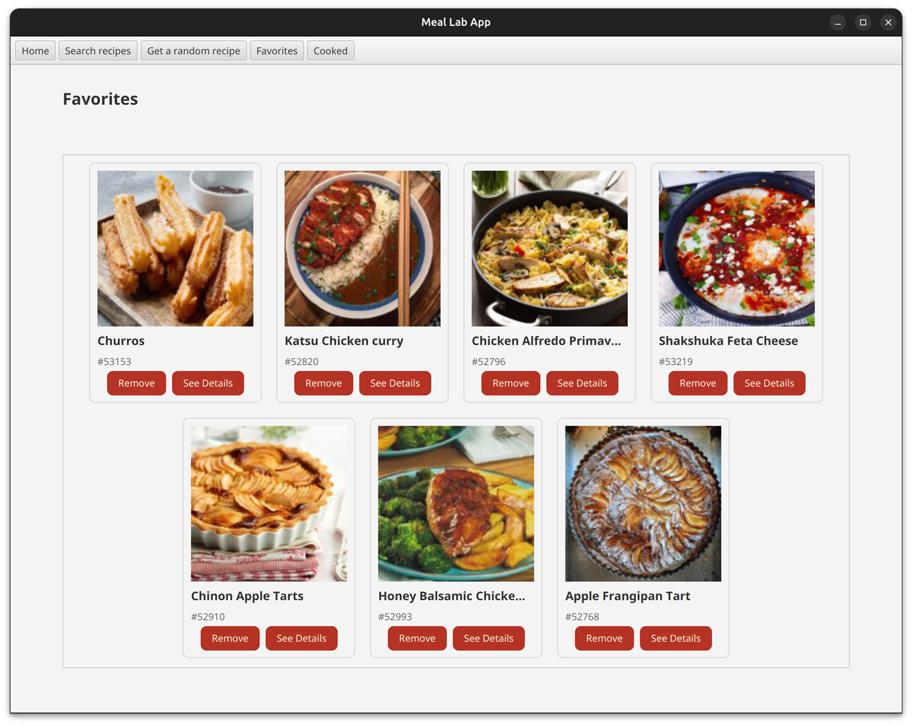
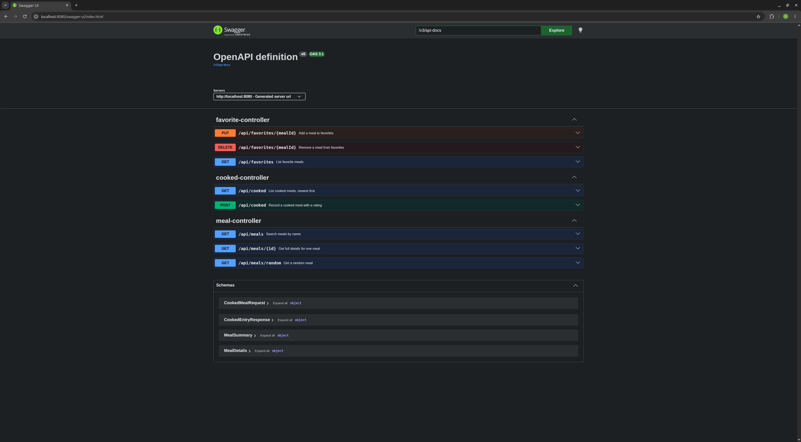

# Meal Lab

[](https://github.com/desp01nad/MealLab/actions/workflows/ci.yml)

A Java recipe project built on [TheMealDB](https://www.themealdb.com/api.php) API. It has a JavaFX desktop client and a Spring Boot REST service for searching recipes, saving favorites and recording cooked meals.



## Features

- Search recipes by name or by ingredient
- Get a random recipe
- View meal details: image, category, origin, ingredients and instructions
- Save meals to **Favorites** and mark them as **Cooked** (persisted locally between runs)
- Custom-styled UI (JavaFX CSS)

## Screenshots

| Meal details | Favorites |
| --- | --- |
|  |  |

## Project structure

- `meal-lab-api` – client library for TheMealDB (HTTP calls, models, error handling)
- `meal-lab-app` – JavaFX application (views, navigation, favorites/cooked managers)
- `meal-lab-server` – Spring Boot REST service (controllers, services, JPA persistence)

The desktop app and the server run independently. The app saves its data to local files and does not use the server.

## Getting started

### Prerequisites

- JDK 21+
- Maven 3.8+
- Docker with Docker Compose (only for running the server)

### Build

From the repo root, build all modules and install them to your local Maven repository:

```bash
mvn clean install
```

### Test

```bash
mvn test
```

### Run the desktop app

The app uses the installed API module, so run the build step first:

```bash
cd meal-lab-app && mvn javafx:run
```

### Run the server

Create your local settings, then set `POSTGRES_PASSWORD` in `.env` to a password of your choice:

```bash
cp example.env .env
```

Start the database and the server from the repo root:

```bash
docker compose up -d --wait
mvn clean install
mvn -pl meal-lab-server spring-boot:run
```

The API runs at `http://localhost:8080`, with interactive documentation at [`/swagger-ui.html`](http://localhost:8080/swagger-ui.html).



## REST API

| Method and path | Purpose | Success | Errors |
| --- | --- | --- | --- |
| `GET /api/meals?name=` | Search meals by name | 200 | 400, 502 |
| `GET /api/meals/{id}` | Get full details for one meal | 200 | 400, 404, 502 |
| `GET /api/meals/random` | Get a random meal | 200 | 502 |
| `PUT /api/favorites/{mealId}` | Add a meal to favorites | 204 | 400, 404, 502 |
| `DELETE /api/favorites/{mealId}` | Remove a meal from favorites | 204 | 400 |
| `GET /api/favorites` | List favorite meals | 200 | – |
| `POST /api/cooked` | Record a cooked meal with a rating from 1 to 5 | 201 | 400, 404, 502 |
| `GET /api/cooked` | List cooked meals, newest first | 200 | – |

Errors are returned as [RFC 9457](https://www.rfc-editor.org/rfc/rfc9457) problem details.

## Using Eclipse

<details>
<summary>Eclipse (embedded Maven) instructions</summary>

1. **Import:** `File` → `Import...` → `Maven` → `Existing Maven Projects`, select the repo root and finish.
2. **Use embedded Maven:** `Window` → `Preferences` → `Maven` → `Installations`, select `Embedded` and apply.
3. **Install API:** right-click `meal-lab-api` → `Run As` → `Maven build...`, Goals: `clean install`.
4. **Run tests:** right-click `meal-lab-api` (then `meal-lab-app`) → `Run As` → `Maven test`.
5. **Run UI:** right-click `meal-lab-app` → `Run As` → `Maven build...`, Goals: `javafx:run`.

</details>

## Credits

Recipe data and images are provided by [TheMealDB](https://www.themealdb.com/), used via its free public API.

## License

Released under the [MIT License](LICENSE). Recipe data and images remain the property of TheMealDB and its contributors.
